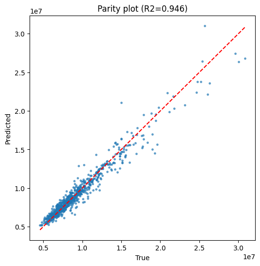
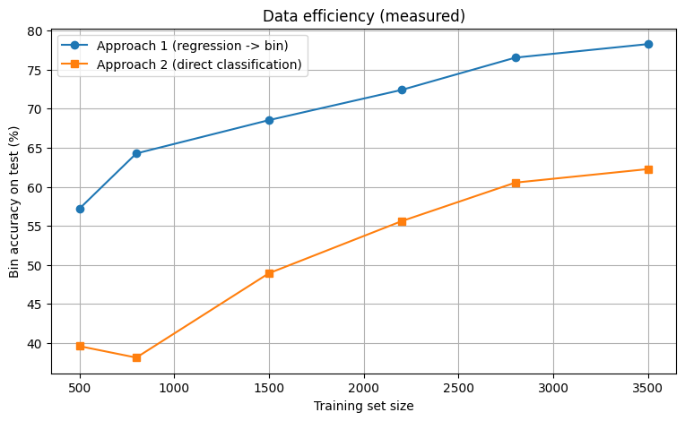

# Stress Prediction from Thickness Profiles (DNN vs CNN)

Predict the **maximum stress** of a part from a 226-point thickness profile, either as a
regression problem or as a 4-class problem (stress percentile bins 0-10 / 11-25 / 26-50 / 51-100 %).

The original 1-D CNN gave poor results (R² = 0.36). A residual **DNN (MLP)** with physics-motivated
features improves R² to **0.946** and 4-class accuracy from 56.5 % to **78.3 %**.

## Results (test set, 750 samples; split 3500/750/750, seed 42)

| Model | R² | RMSE | MAE | Reg→bin acc. | Direct cls acc. |
|---|---|---|---|---|---|
| CNN baseline | 0.359 | 2,956,390 | 2,106,606 | 56.5 % | 49.6 % |
| **DNN (5-seed ensemble)** | **0.946** | **861,257** | **563,385** | **78.3 %** | 62.5 % |

Regression followed by binning beats direct classification at every training-set size
(see `data/figures/07_data_efficiency.png`). All numbers: `data/results/metrics.json`.

| | |
|---|---|
|  |  |

## What changed vs. the CNN

- Features: `1/t` and `log t` per point (stress scales roughly like 1/thickness), standardised
- Target: log(stress), standardised
- Model: 3 residual blocks, width 512, LayerNorm + GELU + dropout 0.1
- Training: smooth-L1 loss, input noise, AdamW + OneCycle LR, best epoch chosen on validation
- 5-seed ensemble
- Why the CNN failed: neighbouring columns are not a spatial signal, and training was unstable/overfit

## Repository layout

```
data/
  DL_data.zip          # input data (not tracked in git - too large)
  figures/             # PNG plots
  models/              # trained weights (dnn_ensemble.pth)
  results/             # metrics.json
notebooks/
  stress_dnn.ipynb            # clean notebook
  stress_dnn_executed.ipynb   # same, with outputs and plots
src/
  load.py   dnn.py   base.py   build_nb.py
```

## Run

```bash
pip install -r requirements.txt
# place DL_data.zip in data/
jupyter nbconvert --to notebook --execute notebooks/stress_dnn.ipynb   # ~1 hour on CPU
# or the standalone script (regression ensemble only):
python src/load.py && python src/dnn.py
```
